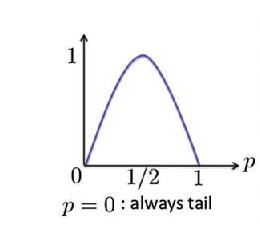
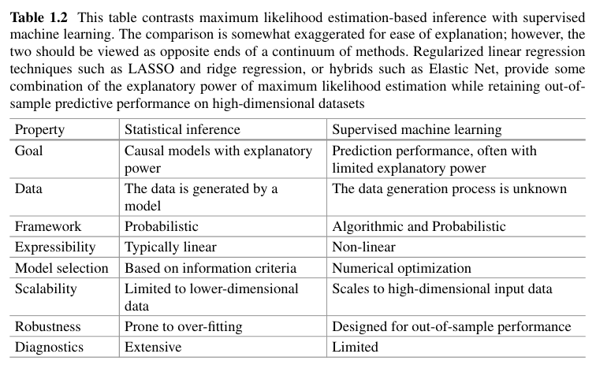

Chương 1. Giới thiệu bối cảnh về học máy áp dụng ở lĩnh vực tài chính.
Phần 1: Motivation.
Ở chương này, tác gỉả cho ta thấy tầm quan trọng của dữ liệu và học máy. 
Dữ liệu cung cấp những thông tin quan trọng như hành vi, xu hướng, hay là mức độ nhằm giúp con người đưa ra các quyết định 
đúng đắn. Trong lĩnh vực tài chính, dữ liệu có thể giúp các nhà đầu tư dự đoán xu hướng thị trường, đánh giá rủi ro, và tối ưu hóa lợi nhuận. 
Học máy là một công cụ mạnh mẽ để khai thác dữ liệu này, cho phép chúng ta xây dựng các mô hình dự đoán và phân tích phức tạp mà con người khó có thể thực hiện một cách hiệu quả. 

Ví dụ:
Một cửa hàng muốn biết trong khoảng thời gian tới, sản phẩm nào sẽ bán chạy nhất để chuẩn bị hàng hóa và chiến lược marketing phù hợp. 
Bằng cách sử dụng dữ liệu lịch sử về doanh số bán hàng, hành vi khách hàng, và các yếu tố thị trường khác, học máy có thể giúp dự đoán xu hướng tiêu thụ sản phẩm trong tương lai.
Từ đó , cửa hàng có thể tối ưu hóa việc nhập hàng, quản lý tồn kho, và triển khai các chiến dịch quảng cáo hiệu quả hơn, từ đó tăng doanh thu và lợi nhuận.

Vậy học máy có thể hiểu một cách như nào?. Một số coi học máy như là một hộp đen (black box) mà đầu vào dữ liệu và đầu ra là kết quả mong muốn, và chúng ta khongo rõ về cách mà mô hình học máy đưa ra quyết định. 
Tuy nhiên, học máy cũng có thể được hiểu như là một quá trình học hỏi từ dữ liệu, nơi mà mô hình tự động tìm kiếm các mẫu và mối quan hệ trong dữ liệu để đưa ra dự đoán hoặc phân loại.
Ví dụ trong một tập dữ liệu có p đặc trưng, thì số lượng quan hệ có sức ảnh hưởng mà nó có thể sản sinh ra là 2^p - p - 1. 
(Tính bằng cách coi mỗi đặc trưng là một biến nhị phân, và loại bỏ các trường hợp không có mối quan hệ nào và các trường hợp chỉ có một đặc trưng duy nhất).

Tiếp theo, trong thời đại số hóa, dữ liệu ngày càng trở nên phong phú và đa dạng. Các nguồn dữ liệu không chỉ đến từ các giao dịch tài chính truyền thống mà còn từ mạng xã hội, cảm biến IoT, và các nền tảng trực tuyến khác. 
Điều này tạo ra cơ hội lớn cho việc áp dụng học máy trong lĩnh vực tài chính, nhưng cũng đặt ra thách thức về việc xử lý và phân tích khối lượng dữ liệu khổng lồ (Big Data) này. 
Thậm chí, việc khai thác dữ liệu từ các nguồn phi truyền thống như mạng xã hội có thể cung cấp những thông tin giá trị về tâm lý và hành vi của nhà đầu tư, giúp dự đoán biến động thị trường một cách chính xác hơn.
Ví dụ như thông qua các bài đăng trên mạng xã hội, các nhà phân tích có thể nhận biết được xu hướng tiêu dùng, sự quan tâm của cộng đồng đối với một sản phẩm hay dịch vụ cụ thể, từ đó đưa ra các dự đoán về nhu cầu thị trường và hành vi mua sắm của khách hàng. 
Bằng cách sử dụng ngôn ngữ tự nhiên (Natural Language Processing - NLP), một phương pháp từ văn bản để lấy được thông tin ngữ cảnh và cảm xúc từ các bài đăng, học máy có thể giúp các nhà đầu tư hiểu rõ hơn về tâm lý thị trường và đưa ra các quyết định đầu tư thông minh hơn.

Với sức ảnh hưởng như vậy, Fintech đang trở thành một lĩnh vực quan trọng trong ngành tài chính, nơi mà học máy và dữ liệu đóng vai trò then chốt. 
Các công ty Fintech đang sử dụng học máy để phát triển các sản phẩm và dịch vụ tài chính thông minh, từ việc quản lý rủi ro, dự đoán xu hướng thị trường, đến việc cá nhân hóa trải nghiệm khách hàng.
Một số lĩnh vực mà học máy đang được áp dụng trong Fintech bao gồm:
- Robo-Advisors: Các hệ thống tự động cung cấp lời khuyên đầu tư dựa trên dữ liệu và mô hình học máy.
- Fraud Detection: Sử dụng học máy để phát hiện các giao dịch gian lận và bảo vệ người dùng.
- Cryptocurrencies: Phân tích dữ liệu từ các giao dịch tiền điện tử để dự đoán biến động giá và xu hướng thị trường.

Phần 2: Phân loại Học Máy.
Học máy là một lĩnh vực rộng lớn và có thể được phân loại thành ba loại chính: học có giám sát (supervised learning), học không giám sát (unsupervised learning), và học tăng cường (reinforcement learning).
- Với học có giám sát, mô hình được huấn luyện trên một tập dữ liệu đã được gán nhãn, nghĩa là mỗi đầu vào đều có một đầu ra tương ứng. Mục tiêu của học có giám sát là học cách dự đoán đầu ra từ đầu vào mới dựa trên các mẫu đã học. 
Ví dụ, trong lĩnh vực tài chính, học có giám sát có thể được sử dụng để dự đoán giá cổ phiếu dựa trên các đặc trưng như khối lượng giao dịch, giá mở cửa, và các chỉ số kinh tế.
Cụ thể hơn, Học giám sát xác định hàm hay là một hộp đen F đến nhận đầu vào là dữ liệu X, đầu ra là Y. 
Mục tiêu làm sao đó để xây dựng hộp đen nhận X có kết quả dự đoán Y' gần với Y nhất'.
- Với học không giám sát, mô hình được huấn luyện trên một tập dữ liệu chưa được gán nhãn, nghĩa là không có đầu ra tương ứng. Mục tiêu của học không giám sát là tìm kiếm các mẫu và cấu trúc ẩn trong dữ liệu. 
Ví dụ, trong lĩnh vực tài chính, học không giám sát có thể được sử dụng để phân nhóm các khách hàng dựa trên hành vi tiêu dùng hoặc để phát hiện các giao dịch bất thường.
- Với học tăng cường, mô hình học thông qua việc tương tác với môi trường và nhận phản hồi dưới dạng phần thưởng hoặc hình phạt. Mục tiêu của học tăng cường là học cách đưa ra các quyết định tối ưu để đạt được phần thưởng tối đa theo thời gian.
Ví dụ, trong lĩnh vực tài chính, học tăng cường có thể được sử dụng để phát triển các chiến lược giao dịch tự động, nơi mà mô hình học cách tối ưu hóa lợi nhuận dựa trên các quyết định mua và bán trong thời gian thực.

*Entropy
Entropy là đại lượng vật lý đặc trưng cho mức độ mất trật tự, hỗn loạn hoặc sự phân tán năng lượng của một hệ thống. Entropy càng nhỏ mức độ chắc chắn càng lớn.
Trong quyển sách này, Entrophy đại diện cho lượng thông tin gắn với từng sự kiện.
Xét bài toán lật đồng xu, Gọi p là xác suất tung được mặt ngửa, từ đó 1-p là xác suất tung được mặt úp.
Vậy Binary Entropy của F với F(Y=1) = p hoặc F(Y=0) = 1 - p:
    H = -p loq(p) - (1-p) loq(1 - p)
 
Có thể quan sát thấy rằng khi p = 0 hoặc p = 1 thì ta H = 0 (Nghĩa là không cung cấp thông tin gì mới vì mỗi lần tung ta đều biết chắc chắn là nó hoặc là úp, hoặc mở) hay nói cách khác độ hỗn loạn nó là 0
Còn tại điểm p = 0 thì H đạt cực đại = 1/2 (Nghĩa là sau một lần tung ta không biết chắc chắn nó là mặt nào hoặc có xu hướng ra mặt nào). Khi đó độ hỗn loạn đạt cực đại 

Giờ chúng ta giả sử, F(y) là phân phối thực tế của tung đồng xu (không nhất thiết là 5 : 5), và ta không rõ là phân phối này bên trong như nào, chỉ quan sát thông qua biểu hiện của nó từ việc tung đồng xu và thu lại mẫu. Ta sẽ sử dụng một hàm tham số G(y,O) với O là tham số, để xấp xỉ nó để có thể đạt được biểu hiện giống như F(y). 
Để đo được sự khác nhau giữa G và F thì ta sử dụng đến Cross Entropy:

H(F, G) =  Tổng của F(y)*log(y|O) trên tất cả y, với y là giá trị trong biến ngẫu nhiên Y

Trong bài toán lật đồng xu như trên, ta được như sau 
H(F,G) = - p*log(q) - (1-p)*log(1-q) >= H(F) = - p*log(p) - (1-p)*log(1-p) 
Cái này có thể chứng minh bằng cách đạo hàm tìm cực trị thì ta sẽ đc thấy cực trị nếu như q = p

Đây là lí do vì sao học mấy lại có thể học được phân phối bất kì.

*Neuron Network 
Là một mạng lưới lấy cảm hứng từ hình dạng neuron não bộ.
Ta xét đến X là tập hợp thông tin (neuron) hoặc tín hiệu đầu vào x1, x2, x3, ..., x_n. Y là tập hợp các thông tin mới được tạo từ các tín hiệu X và W là trọng số thể hiện mức độ hiện diện của tín hiệu x đối với y. Trọng số w càng nhỏ nghĩa là mức độ đóng góp của nó trong việc tạo ra y càng ít. 

Một Neuron Network có 3 lớp chính: Lớp đầu vào, Lớp ẩn, Lớp đầu ra 
Lớp đầu vào chính là tín hiệu đầu tạo ra những thông tin mới ở lớp ẩn.
Lớp ẩn sẽ xếp chồng với nhau, lớp sau sẽ lấy thông tin mới như là tín hiệu đầu vào.
Lớp đầu ra là lớp nhận tín hiệu từ lớp ẩn và đưa ra kết quả dự đoán hoặc trạng thái mong muốn. 

Độ rộng của Neuron Network sẽ được tính qua có số lượng neuron ở trong lớp ẩn, còn độ sau sẽ được tính thông qua số lớp ẩn có trong network đấy.

Fact không chuẩn lắm: 
- Tăng độ rộng cho neuron network giúp cho tăng khả năng học những phân bố phức tạp hơn, tuy nhiên nó sẽ tăng gánh nặng cho việc tính toán, hiện tượng quá khớp, tốn bộ nhớ, ...
- Chính vì vậy, người ta không chỉ tăng độ rộng, người ta còn tăng độ sâu (nên mới có câu deep neuron network).

Ví dụ như: 
Thay vì một neuron network có số neuron ở lớp đầu vào, lớp ẩn, lớp đầu ra như sau 5, 20, 3. Số tham số phải học là:
5*20 + 20*3 = 160 tham số.
Ta có thể chia 20 neuron của 1 lớp ẩn thành 4 lớp ẩn mỗi lớp 5 neuron. Số tham số phải học là:
5*5 + 5*5 + 5*5 + 5*5 + 5*3 = 115 tham số 
Và cùng một số lượng neuron tuy nhiên tham số ít hơn 45, tất nhiên là này cũng chưa chứng minh được cái nào đúng hơn, nhưng thường thì việc tăng độ sâu có thể cho khả năng học được phân phối phức tạp gần như tương đương, nhưng với tốc đọo nhanh hơn và nhẹ hơn.
Và cái này nó là một trade-off để ta có thể điều chỉnh tùy vào mục đích.

*Statistic Modelling vs. Machine Learning
Ở phần này, người ta phân biệt giữa Supervised machine learning và Statistical model.
Supervised ML là một dạng thuật toán của Statistic model. Sự khác nhau được thể hiện hình ảnh ở bên dưới  

Ngoài ra thì tác giả còn giới thiệu và phân biệt parametric models và non-parametric models (mô hình tham số và mô hình phi tham số).
- Parametric model sẽ coi tập hợp tham số là hữu hạn, và đóng vai trò một hàm số chứa tham số và các biến đầu vào.
Và chính vì có sự giới hạn về không gian tham số (hữu hạn), khiến sự linh hoạt bị giới hạn và không thể học được các quy luật trong dữ liệu lớn.
Parametric model sẽ bao gồm, hồi quy tuyến tính, hồi quy lũy thừa, mô hình hỗn hợp (Mixture models), mạng neuronneuron, mô hình Markov.
- Non-parametric models lại coi không gian tham số là vô hạn, điều này tương đương với việc sử dụng một hàm ẩn (laten funtion).
Vì cấu tạo của nó, mà mô hình này có thể phát triển cùng với độ phức tạp của data.
Các mô hình phi tham số sẽ bao gồm SVM and Gaussian Processes.
+ Về hàm ẩn hoặc chức năng ẩn (latent fucntion) trong xã hội học là hệ quả hoặc kết quả không được chủ đích lên kế hoạch, ít rõ ràng và thường không được nhận thức ngay từ đầu của một hoạt động, hành vi hay thể chế xã hội.
Liên hệ qua học máy thì nó sẽ có vẻ liên quan đến latent space (trong việc nén ảnh) nghĩa là nó sẽ chứa thông tin đặc trưng của đầu vào mặc cho kích thước của dữ liệu.

Và cũng trong phần này, tác giả còn phân biệt mô hình xác suất (probabilitic) và mô hình xác định (determistic).

*Reinforcement Learning.
Về học tăng cường, nhìn chung nó sẽ là quá trình lặp lại từ việc đưa ra các hành động tương tác với môi trường,
đánh giá, tăng cường. 
Một trong những ví dụ trong bài nói đến một trường phái của học tăng cường.
Đó chính là ví dụ 1.4 Uncertain Payoff sử dụng đến Dynamic Programing (về mặt ý tưởng).

Dynamic Programing về mặt ý tưởng phát triển bộ quy tắc (policy) làm sao đó để tối ưu lợi ích về lâu dài.
Để đo được lợi ích thì ta sẽ có 2 thứ đầu tiên phần thưởng (rewards có thể âm hoặc dương) và hàm giá trị (value funtion)
người ta hay sử dụng return (giá trị hoàn trả) làm value function (nghĩa là tổng phần thưởng tính từ trạng thái đó cho đến khi kết thúc chu trình).  

Quay lại ví dụ 1.4:
Bài toán cho vốn 600 đô, ta phải phân phối vào 3 thị trường lần lượt là M1, M2, M3.
Nghĩa là phân phối cho M1 trước rồi mới đến M2 rồi M3. Mức phân phối chia thành 3 phần {100, 200, 300}.
Và lợi nhuận sẽ đc 1% nếu như đầu tư thành công.

Ở bảng bên trái ta sẽ có được thông tin chi tiết với fill probability là khả năng đầu từ thành công với mức đó.
Trong bài này, expected return sẽ được dùng như là một tín hiệu phần thưởng.
Ví dụ: ở M1, nếu ta chọn bỏ 100 đầu tư expected return sẽ bằng:
E = 100*0.01*0.8 + 0*0.2 = 0.8
Và bảng bên phải return tương ứng với từng mức allocation. 
R1(x), R2(x), R3(x) là hàm phần thưởng tương ứng với từng mức allocation.
Ví dụ: R1(100) = 0.8 
Ta có process của nó là đi từ M1 -> M2 -> M3. Ta định nghĩa V1(x), V2(x), V3(x) là hàm giá trị (value funtion) của trạng thái.
Lúc đấy, V3(x) = R3(x) với x thuộc K = {100, 200, 300}
        V2(x) = max[ R2(k) + V3(x-k)]  với x thuộc K + 200 
        V1(x) = max [ R1(k) + V2(x-k)] với x = 600
Thật ra thì bài toán đơn giản như việc chọn tổ hợp (M1, M2, M3) sao cho
M1 +M2 +M3 =600 sao cho V1(x) lớn nhất
Tuy nhiên thì ta sẽ làm lần lượt ngược lên từ M3 -> M1
Nhìn  bảng 1.4 continued:
Với M3, thì đây là state cuối nên ta không xét
Với M2, x = 300, ta tính V2(300) = max(2.25, 2.15) = 2.25 khi M2= 100, M3 = 200 
        x = 400, ta tính V2(400) = max(2.55, 2.9, 2.7) = 2.9 khi M2 = M3 = 200 (nhìn theo đường chéo của bảng kiểu như M2+M3 =400) 
        x = 500, ta tính V2(500) = max(3.2, 3.45) = 3.45 khi M2 = 300, M3 = 200 
Với M1, x = 600, V3(600) = max[ R1(300) + V2(300), R1(200) + V2(400), R1(100) + V2(500)]
                         = max[ 1.8 + 2.25, 1.4 +2.9, 0.8 + 3.45] = max[4.05, 4.3, 4.25]
                         = 4.3 khi M1 = M2 = M3 = 200

*Ví dụ sử dụng Học giám sát trong thực tế.
Algorithmic Trading

Ta có bài toán, chiến lược của công ty đầu tư cổ phiếu là đầu tư đều và theo hướng long-only (chỉ mua và nắm giữ cổ phiếu)
Và ở đây ta có 2 thành phần một là các portfolios (danh mục cổ phần) và the S&P 500 index.
Mục tiêu ở đây là thay ví xác định excessive return (suất sinh lợi) của portfolios so với S&P là bao nhiêu
Thì ta sẽ label nó như kiểu có nên đầu tư vào portfolio hay ko.
Từ đó bài toán đã chuyển từ regression thành classification.
Và ta tạo ra biến quyết định G như label của dataset. Bằng cách excessive return > epsilon thì G =1 và ngược lại   
Dataset bài toán lựa chọn chính là expected returns của 5 ngày gần đây nhất.

*High Frequency Trade Execution

Giờ trước hết ta cần hiểu về limit order book trước.
Limit Order Book là một nơi lưu trữ liquidity (thanh khoản).
Các liquidity có 2 yếu tố:
+ Price: giá của 1 đơn vị trong thanh khoản.
+ Sô lượng: Bid Hoặc Ask, tương ứng với 2 vai trò (Muốn Mua hoặc Muốn Bán).
Ví dụ: thanh khoản như sau:  price   |   Ask
                             $100    |   10
                             Nghĩa là có người muốn bán 100 đô cho 1 phần và họ có 10 phần.
                Bid   |    Ask
                $100  |    10
                Nghĩa là có người muốn mua 1 phần với giá 100 đô và họ muốn mua 10 phần.

=> Từ đây cuốn sách nó chia thành 2 phần là một phần ASK side và BID side. 
- Một phần là tập hợp thanh khoản ASK ở phía trên. 
Nó sắp xếp theo price từ giá thấp đến cao (level). Nó dựa trên tâm lý của người mua muốn mua với giá thấp của bên bán. 
Phải mua hết phần của mức giá này thì mới đến mức giá tiếp theo (Mua hết phần của level này).
-> Hay nói cách khác càng khớp lệnh nhiều bên ASK (mua vào nhiều) thì càng đẩy giá lên cao.
- Một phần là tập hợp thanh khoản BID ở phía dưới.
Nó sắp xếp theo price từ cao xuống thấp(level). Nó dựa trên tâm lý của bán muốn bán với giá cao nhất của bên mua.
Phải bán hết phần của mức giá này thì mới đến mức giá tiếp theo (bán hết phần của level này).
-> Hay nói cách khác càng khớp lệnh bên BID (bán ra nhiều) thì giá càng giảm.

Ở trong Market này thì có 2 Role:
- Maker: Người đặt thanh khoản vào book (cả 2 phía Bid và Ask). (Buy Limit và Sell Limit )
- Taker: Người lấy thành khoản trong book hay còn gọi là khớp lệnh. (Đưa ra số lượng muốn mua hay bán ở Ask và Bid).
(Buy Market và Sell Market)

Vậy thì từ những thông tin này thì ta có gì:
Trước hết, ta tìm hiểu về spread 
spread = best Bid (giá thấp nhất bên mua) - best Ask (giá cao nhất bên bán)

Trong môi trường như này mọi thứ diễn ra rất nhanh, thị trường thay đổi liên tục.
Và với vai trò là một Taker ta cần phải tìm cách ăn lời thông qua spread, nghĩa là mua ở giá thấp nhất
và bán ở giá cao nhất. 

Và đây chính là lúc học máy can thiệp vào việc dự đoán giá cả trong tương lai,
xem xu hướng giá mua đang tăng hay ko, và giá bán có đang giảm hay ko bằng cách dùng lịch sử giao dịch.
Từ đó đưa ra chiến lược mua và bán đúng thời điểm để khớp lệnh.

Tuy nhiên, với cách này thì ta khá bị động vì phải quan sát thị trường.
Còn một cách khác tuy nhiên cần rất nhiều tài lực. 
Đó chính là sử dụng học tăng cường để đưa ra các chiến lược để kích thích thị trường.
Tưởng tượng như bây giờ ta không phải là Taker nữa mà ta sẽ đóng vai trò như 
Vừa là Maker và Taker, 
+ Maker là người nắm thế chủ động trên thị trường khi có thể đặt thanh quản vào book
+ Taker là người quan sát và kiếm lời từ nó.

Vậy là Maker sẽ tạo ra môi trường tốt nhất để cho Taker ăn lời.

*Mortgage Modeling

Ở đoạn trước thì tác giả có giải thích này giống như một mô hình dự đoán trạng thái trong tương lai
của nợ công của hộ gia đình, hoặc cá nhân 

Về miêu tả về model thì ta nói đến các trạng thái của nợ.
Paid(P) là nợ được trả đủ.
Current(C) là Người vay đang trả đúng hạn
30-days deligquent(3) là Chậm trả một kỳ
60-days delinquent(6) là Chậm trả hai kỳ
90+ days delinquent(9+) là Chậm trả từ ba kỳ trở lên
Foreclosure(F) là Đã bắt đầu thủ tục tịch thu tài sản
REO(R) là Tài sản đã thuộc quyền sở hữu của bên cho vay sau thủ tục tịch thu
Default liquidation(D) là Khoản vay được thanh lý bắt buộc do không trả nợ

Thông thường thì các trạng thái nó sẽ chuyển như sau:
        P->C→3→6→9→F→R->D
Nghĩa là nếu mà ko đạt điều kiện như không trả nợ hoặc trể hạn thì phải chuyển sang trạng thái tiếp theo.

Và ở đây mô hình sẽ học xác suất chuyển trạng thái (Transition Position)
Trong sách có thể mô tả xác suất chuyển trạng thái thông qua Markov matrix:
Trong đó có một số trạng thái có thể bị đảo ngược ví dụ như 3 -> C chẳng hạn (bạn chậm kì nhưng mà bạn trả đủ chẳng hạn)
Và cũng có một số trạng thái không đảo ngướcj được vì nó giống như quy tắc nghiệp vụ
Chính vì vậy có một số xác suất chuyển trạng thái có giá trị bằng 0 

Ngoài các state đẫ cho, tác gỉa còn nhận mạnh có thêm một số state bổ sung và thường dễ bị nhầm lẫn với state đã cho.
Như 

- Turnover(T) thường nhầm(overlap) với P: Khoản vay được trả hết do sự kiện đời sống phi tài chính, chẳng hạn chuyển nhà
- Curtailment(U) thường nhầm (C) là Người vay trả thêm để giảm dư nợ gốc, nhưng khoản vay vẫn tiếp tục

** Model Stability 
Ở đây tác giả đang nhận mạnh sự ổn định của mô hình và những điểm chết của mô hình.
Tác giả đưa bằng chứng ở đây thônng qua 2 biểu đồ:
- Fig 1.9 biểu trưng cho model học sample trong quá khứ và fit rất tốt và dữ liệu.
- Fig 1.10 tác giả chỉ ra rằng cũng model này nhưng khi cho nó dự đoán cho tương lai ta sẽ thấy sự sai lệnh.
Cụ thể hơn là ở giai đoạn đầu (->40) thì ta thấy nó vẫn bắt được mối quan hệ, nhưng mà vẫn cao hơn so với thực tế (observed).
Tuy nhiên sau giai đoạn này thì nó nhớ quan hệ từ dữ liệu quá khứ (có thể thấy nó giống như fig 1.9)

Tác giả đề cập nguyên nhân rằng:
+ Ở dữ liệu quá khứ mô hình đã học được mối quan hệ giữa tuổi đời của nợ với mục tiêu.
Tuy nhiên ở dữ liệu mới hơn, dữ liệu khác, nó không còn phụ thuộc vào mối quan hệ này nữa.
(The regime shown here is clearly not driven by age trích tác giả). Và không có dữ liệu tốt đúng trước khủng hoảng.

+ Kể cả khi tăng đọ phức tạp cũng không thay đôi quá đáng kể cho kết quả. 
Tác giả nhấn mạnh rằng mô hình này phải giữ được sự ổn định, để chưa ra sự chính xác nhất có thể.
Kể cả khi phân phối có bị thay đổi mạnh mẽ đi chăng nữa.
(Mortgage models in particular place a high premium on model stability,
and the ability to provide as much accuracy as possible even though the underlying
distribution may have changed dramatically from the one that generated the fitting
data.)
