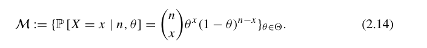
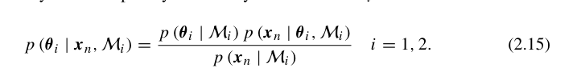

Chương 2: Mô hình xác suất.

Mục tiêu của chương này:
+ Giới thiệu và áp dụng Bayesian suy từ dũ liệu
+ Hiểu cách hồi quy tuyến tính với trọng số xác suất lại có thể xem là một mô hình đò thị xác suất cơ bản 
+ Phát triển biểu diễn các loại dữ liệu phức với mô hình đồ thị xác suất như là Mô hình hỗn hợp (Mixture Models) and Hidden Markov Model.

Phần đầu tiên, tác giả nói đến là giới thiệu về Bayesian Estimation. 
Bằng cách, so sánh với Classical (Frequentist) Estimation để làm rõ hơn ý tưởng của Bayesian Estimation. (Khác trong cách nó sử dụng xác suất và cách nó xử lý với các tham số).

*Priors (Xác suất tiền nghiệm).
Trước hết, ta cần hiểu về cái này, tác giả nói rằng priors là những xác suất đã được lập hoặc nhận định về một sự kiện không chắc chắn.
Ví dụ như kiểu xác suất của đồng xu là 5 : 5 vậy, trong thực tế thì chưa biết như nào.
Mặc dù, priors dùng để chỉ các sự kiện không biết tới, tuy nhiên nó được định nghĩa là phân phối có thể xác định.
Ví dụ như: Chiều cao của Nam sinh Bách Khoa có kỳ vọng là 163 cm với phương sai là 20 cm.

Đại lượng này thường ẩn đi trong classical estimation. Và trong classical world, tất cả dự đoán và suy đoán dựa trên dữ liệu quan sát.

*Parameters (Tham số) 
Cả hai trường phái (Bayesian và Classical) đều hướng tới việc học được một bộ tham số mà nó thường cố định nhưng lại là những yếu tố không biết trước và thường liên quan đến population of interest.

Quần thể quan tâm (Population of Interest) là toàn bộ nhóm đối tượng cụ thể mà nhà nghiên cứu hoặc doanh nghiệp muốn tìm hiểu, thu thập dữ liệu và áp dụng các kết luận thống kê lên đó.
Ví dụ như: Chièu cao trung bình của nam sinh Đại học Bách Khoa

Và đây là một trong những điểm chung trong cả 2 trường phái, và điểm chung còn lại đó chính là likelihood function.

*Likelihood function:
Tác giả định nghĩa nó là xác suất p(y| W,X) với y là một biến phụ thuộc vào ma trận các biến có khả năng giải thích X (nghĩa là X có giải thích cho đầu ra y), cùng với W là bộ tham số. 

Đến đây, Tác giả bắt đầu chỉ điểm khác biệt giữa 2 trường phái.
+ Classical 
- Đầu tiên, ở trường phái classical, từ việc thu thập các mẫu quan sát từ những quần thể quan tâm và kêt hợp với các mô hình thống kê, để ước lượng bộ tham số cho một bộ thực sự. Tuy nhiên, giá trị ước lượng này nó chỉ đại diện cho với mẫu quan sát đấy không phải toàn thể quần thể. Chính vì vậy, với mẫu khác biệt có thể đưa ra sự khác biệt ở giá trị ước lượng. Những sự sai khác (không chắc chắn) trong giá trị này có thể được giải thích thông qua sai số chuẩn được gắn vào mỗi giá trị của giá trị ước lượng của tham số.

- Thứ hai, ở trường phái classical, họ cũng tập trung vào biểu hiện của bộ tham số ước lượng khi mẫu tăng lên, và cho rằng là giá trị bộ tham số sẽ hội tụ khi mẫu tăng lên vô hạn theo lý thuyết tiệm cận.

Tuy nhiên, trong thực tế kích thước mẫu thường hữu hạn, và không đủ lớn để xấp xỉ, vì vậy nó chính là một trong giới hạn của phương pháp này.

Hay nói cách khác, ở trường phái classical, họ tìm và ước lượng tham số sao cho tối đa hóa giá trị likelihood.

+ Bayesian 
- Ở đây họ lại sử dụng xác suất tiền nghiệm (priors) và likelihood qua định lý Bayes để truy ra phân phối hậu ngiệm của bộ tham số. Tác giả nói rằng phân phối hậu nghiệm chính là bản cập nhật của xác suất hậu nghiệm. Nó tỉ lệ với xác suất hậu nghiệm nhân với likelihood.
- Trong đó, priors có thể hiểu là niềm tin ban đầu của chúng ta về mẫu thu thập được. Còn likelihood chính là thực tế, nó mang thông tin về dữ liệu và bộ tham số. Chính vì vậy nếu như dữ liệu mang nhiều thông tin thì phân phối hậu nghiệm sẽ có thể hơi khác với priors. Lấy ví dụ như priors (niềm tin) của chúng ta về tung đồng xu là 5 : 5, tuy nhiên trên thực tế nó lại là 2 : 8 chẳng hạn.
- Ngoài ra, tác giả còn nhắc đến 2 phương pháp cập nhật hậu nghiệm dựa trên tiền nghiệm lặp lại như stochastic filtering và MCMC.  
=> Tổng quan lại Bayesian thu thập dự liệu để cập nhật prior 

*Frequentist Inference from Data
Ở phần này ta chỉ rõ các bước để ước lượng từ sample đã cho (Xem trong sách)

Ta sẽ bắt đầu với ví dụ trong sách. (Bernoulli Trials Example)
Hay là ví dụ tung đồng xu. 
+ Bước 1: Xác định hàm likelihood 
Thì ta đã biết nếu cho trước xác suất o, xác suất đầu ra y là p(y|o) = o^y x (1-o)^(1-y) với y thuộc [0,1] 

Ta có: Y là biến ngẫu nhiên Bernoulli, Y = (y1, y2, y3, ..., yn) với n là số mẫu, và y_i là kết quả của lần tung thứ i  

+Bước 2: Xác định hàm livelihood.
p(Y|o) = o^(sum(y_i))+o^(n-sum(y_i))

+Bước 3: tìm điểm cực trị.
Sau các bước đạo hàm, thì ta sẽ có điểm cực trị o* 
o* = sum(y_i)/n

Và từ mẫu của ví dụ ta tính đc: o* = 0.24 
=> kết luận là xác suất ra head là 24%

Tiếp đến làm sao để đánh giá được giá trị ước lượng vừa rồi.
* Bias và Variance:

Bias được định nghĩa như sau:

bias(o',o*) = E(e) = E[o' - o*] = E[o'] - E[o*] = E[o'] - o* 

Với o' là giá trị ước lượng, o* là giá trị thật sự. e là error

Dựa từ ví dụ trên, ta có bias(o', o*) = 0  nghĩa là việc tung đồng xu này là unbias hay nói cách khác bạn tung càng nhiều bạn càng tiến tới giá trị thật.

Variance của ước lượng này được tính như sau.

Var[o'] = Var[sum(y_i)/n] = 1/n^2 x Var[y_i] = 1/n x o*(1-o*)
=> Cho thấy là variance phụ thuộc vào giá trị thật của mẫu.

Ngoài ra, tác giả còn nhắc đến việc sử dụng los function như mean square error hoặc mean absolute error để giảm lỗi ước lượng.

Sang phần quan trọng tiếp theo, là phần làm sao để bộ tham số có thể học được từ mẫu cho trước.
*Bayesian Inference from Data

Các bước như sau:
1. Lập mô hình xác suất như là một bộ biểu diễn phân phối xác suất có điều kiện dựa trên giá trị của tham số. Ví dụ: p(.|o) với o là tham số mà bạn muốn học
2. Tổ chức hoặc quan niệm hóa về giá trị của tham số o (priors). Ví dụ như nó có vẻ là theo phân phối gì, quy luật ra sao.
3. Thu thập data và thêm nó vào họ phân phối ở bước 1
4. Sử dụng định lý Bayes để ước lượng lại niềm tin bề priors
5. Đánh giá mô hình và kiểm tra lại giả định về mô hình.

Trở lại với ví dụ tung đồng xu:
Bước 1,2: Ta giả định về mô hình, khi mà ta chưa biết về môi trường ta giả định mọi thứ đều có xác suất như nhau. Và áp dụng quy luật Laplace về indifference (sự thờ ơ không biết nên dịch như nào), ta coi prior là uninformative (không mang thông tin). Hay nói cách khác ta giả định prior ban đầu tuân theo phân phối đều (uniform) U(0,1) vì giá trị tham số đi từ 0 -> 1. Lúc đó:
p(o) = 1 với mọi o từ 0 -> 1
Bước 3: Thu thập dữ liệu, đã cho trước rồi
Bước 4: Từ sự giả định về priors ta suy ra posterior 

p(0|x_1:n) == p(x_1:n|o) * p(o) = o^(sum(x_i))+o^(n-sum(x_i))

Ví dụ khi n = 5, dựa trên dữ liệu thì ta có  p(0|x_1:n) = o(1-o)^4 là phân phối của xác suất để ra được mặt ngửa (head)

Khi n tăng lên 10, nghĩa là ta thu thập thêm thì lúc này ta lại có phân phối mới p(0|x_1:n) = o^2 x (1-o)^8

Và ta quan sát thấy phân phối này giống phân phối Beta hay nói cách khác

O ~ Beta(sum(x_i), n - sum(x_i))

Khi n = 50 thì phân phối hậu nghiệm: O ~ Beta(12,38).
Lúc này: Kỳ vọng của o là E[o] = 0.24 và Var[o] = 456/12750 (Xem chi tiết trong sách).

Điểm quan trọng khác biệt với frequentist thì thay vì khẳng định xác suất xảy ra sự kiện mặt ngửa là 0.24, Bayesian không nói thế mà chi đưa ra phân phối cho khả năng xác suất ra mặt ngửa. Nghĩa là có thể xảy ra trường hợp xác suất ra mặt ngửa là 99% nhưng mà rất nhỏ. 

Từ đây, ta lại cũng có lại niềm tin của mình về priors, rõ ràng là chúng ta đã thấy nó có vẻ tuân theo phân phối Beta. Vậy giờ ta lại giả định nó theo phân phối Beta thay vì phân phối đều. Lúc đó, ta lặp lại quá trình.

Bước 1,2: Xác định priors. Giả sử: O ~ Beta(a,b)

p(o) = o^(a-1) x o^(b-1), với mọi o từ 0 -> 1

Từ đó ta có được xác suất hậu nghiệm như trong sách (trang 60).

Khi đó phân phối của prior và posterior giống nhau (cùng một họ phân phối) hay còn gọi là conjugate distribution.

Lúc đó thì kết quả ước lượng lại phụ thuộc vào việc lựa chọn a và b.

*Sequential Bayesian Update.
Vậy khi có dữ liệu mới, làm sao để cập nhật:
Trước hết, quay lại ví dụ tung đồng xu, bắt đầu với prior là
Beta(a,b) từ đó ta có posterior là Beta(a+sum(x_i), b +n - sum(x_i)) (*)

Nếu dữ liệu đầu là n = 1, ta có prior là Beta(a,b) => posterior là Beta(a+x1, b+1-x1)

Sau đó dữ liệu hay lần tung thứ 2 thì ta lại lấy posterior lần tung 1 là prior lần tung thứ 2: Beta(a+x1, b+1-x_1). lúc đó, posterior lần tung thứ 2 là  Beta(a+x1+x2, b+2-x1-x2).

Và nếu cứ làm như vậy ta sẽ đc kết luận giống như công thức ở trên (*)

Và cơ chế này chính là nền tảng cho Sequential Bayesian Update.
Và một trong phương pháp đó là Online Learning. 

*Online Learning

Coi y' là dữ liệu mới, thì posterior của y lại trở thành prior, lúc đó posterior mới như trong công thức sách (likelihood mới nhân với prior cũ)

Vậy là sao từ dữ liệu y ta dự đoán dữ liệu mới y' 

Đó chính là phần prediction trong sách.
Ta sẽ lấy ví dụ luôn như bài tung đồng xu khi nãy.
Giả sử ta đặt m = a + sum(x_i), k = b+n-sum(x_i), ta có posterior là Beta(m,k)

ta có, y cung cấp số lượt úp và lượt m, còn o cung cấpcho ta biết xác suất ra mặt ngửa là bao nhiêu. 
Từ đó, ta có 
p(y'|y,o) = o và E[o|y] = số mặt ngữa/n = sum(x_i)/n

Lúc đó:
p(y'=1|y) = intergral_from_0_to_1(o*p(o|y))= E[o|y]=sum(x_i)/n = o_ml
p(y'=0|y) = intergral_from_0_to_1((1-o)*p(o|y))=1- E[o|y]=1- sum(x_i)/n = 1- o_ml

p(y'|y) = o_ml^y' * (1-o_ml)^(1-y')

Ngoài ra, tác giả còn nói đến việc áp dụng trong thực tế.
+ Đầu tiên với trường hợp mẫu lớn, và hàm likelihood có khả năng biểu diễn o (hay nói cách khác là một hàm đơn giản và xác định được 1 cực đại). Với trường hợp này sử dụng Bayesian hay Classical đều ổn và không có sự khác biệt.

+ Thứ hai, ở trường hợp mẫu lớn, và hàm likelihood phức tạp hơn, không tuyến tính. Trong trường hơp này, thì Bayesian cũng có chút lợi thế trong việc tính toán, bởi vì những hàm likelihood như vậy khi xác định được điểm cực trị thông qua MLE cũng tốn rất nhiều tài nguyên tính toán, trong khi Bayesian chỉ xác định phân phối của giá trị ấy, thông qua phân phối đã biết, giúp nó rẻ hơn.

+ Cuối cùng là mẫu nhỏ, Bayesian cũng có lợi thế hơn Classical. Đầu tiên, Bayesian không phụ thuộc lý thuyết tiệm cận. Thứ hai, Nó còn kết hợp dữ liệu thưa cùng với prior. Nếu có thể xác định prior tốt, nó có thể tăng được độ chính xác và hiệu suất của mô hình. Hay nói cách khác, lúc này, việc chọn cách tiếp cận dựa trên việc tin tưởng lý thuyết tiệm cận hay priors. 

*Model Selection 
Ở chương này tác giả đưa ra mộ vấn đề là có 3 mô hình từ bài toán hồi quy tuyến tính, nếu chỉ sửa dụng Residual Sum Of Squares (RSS) hay là MSE thì tất cả đều ra kết quả 1%. Và 3 model này đều khai thác các feature input khác nhau. Câu hỏi đặt ra là 
+ Model nào tốt nhất?
+ Làm sao để giải thích biến (features) nào quan trọng nhất trong các model đấy?
+ Bạn có đưa ra kết luận khác nhau về các tín hiệu thị trường nếu chọn Model 1 thay vì Model 2 không?
+ Làm sao loại bỏ sự mơ hồ khi các mô hình cho kết quả gần giống nhau?

Ngoài các câu hỏi này tác giả còn nhấn mạnh sử dụng các con số như F1 hay MSE đôi khi sẽ không tốt trong việc đánh giá trong dữ liệu phức nơi mà có nhiều biến độc lập với nhau. Điều này dẫn đến đưa ra kết luận khác nhau mặc dù trên cùng một mẫu dữ liệu. 

**Bayesian Inference
Tác giả nói, trong phép suy Bayesian, một mô hình là a thành viên trong một phân phối xác suất, mỗi phân phối có thể giải thích cho dữ liệu quan sát. Một cách chính xác, mô hình M là tập hợp các hàm likelihoods p(x_n|o) over all possible parameter values.

Lấy ví dụ lật đồng xu n lần và quan sát được x lần mặt ngửa, khi đó, mô hình sẽ là một họ của phân phối nhị phân 

Lúc đó, định nghĩa lại công thức Bayesian:

**Model Selection
Ta giả sử mô hình M có mối quan hệ tương ứng với tham số o. Để tìm xem mô hình nào phù hợp dựa trên dữ liệu quan sát cho trước. Bước đầu ta định nghĩa và sử dụng định lý Bayes cho xác suất mô hình hậu nghiệm (posterior model probability).

Ý tưởng của nó tương tự khi nó làm với bộ tham số. Xác suất hậu nghiệm sẽ bằng prior p(M) nghĩa là giả định về mô hình ban đầu. Cái còn lại là hàm biên likelihood hay còn gọi là model evidence.

***Model Evidence 
Tại sao lại gọi là marginal likelihood model bởi vì xác suất này được tạo bởi một hàm likelihood có vai trò như mang thông tin của dữ liệu  nhân với hàm likelihood có vai trò mang thông tin về bộ tham số từ những giả định về mô hình cho trước. 

Chính vì vậy, trong góc nhìn về việc lấy mẫu, hàm cận biên likelihood này có thể xem như một cái xác suất mà mô hình có thể tạo ra được dữ liệu, dưới những niềm tin (prior) về tham số.  

Ngoài ra, model evidence còn được sử dụng để so sánh giữa 2 model thông qua posterior odds ratio. Và tiêu chí được chọn thì dựa trên Jeffrey's scale. 

Ví dụ như vẫn là bài tung đồng xu ở phía trên ta sẽ định nghĩa model M1 cho rằng xác suất ra mặt ngửa là biết trước và bằng 0.5 và model này không chứa tham số(vì nếu coi xác suất là 1 tham số thì nó đã biết rồi).

Trái lại, Ta định nghĩa M2 cho rằng xác suất ra mặt nghĩa là một tham số chưa biết, và tuân theo phân phối đều.  

Từ những dự kiện trên, model evidence M1 là 0.005956, model evidence là 0.004975. => logarit của  posterior odds ratio = 1.2 => chưa đủ để kết luận giả thuyết ở mô hình 1.

*Probabilistic Graphical Model 